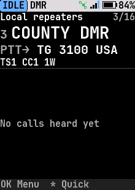
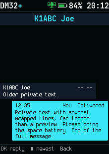
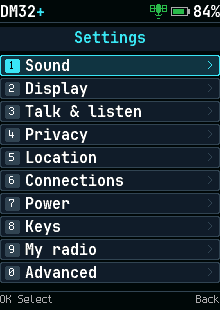
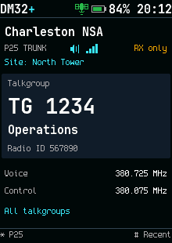
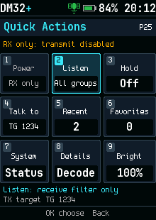
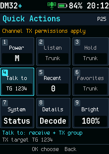
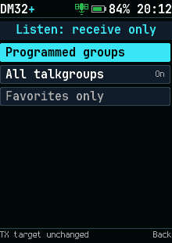

<!-- SPDX-License-Identifier: MIT -->
<!-- Copyright (c) 2026 Garrett Dothard -->

# DM32Plus

**DM32Plus (DM32+) is MIT-licensed firmware and a browser-based CPS for the Baofeng DM-32UV.**
Built on [RadioFoundry](https://radiofoundry.org), it adds a card-based interface, FM and DMR operation,
P25 Phase 1 conventional and trunked operation, persistent DMR conversations, and integrated programming and updates.
Commercial use is permitted under the [MIT license](LICENSE).

This fork publishes firmware for the DM-32UV. The shared core and other board references inherited from
RadioFoundry remain in the tree; they are not a promise of DM32Plus releases or hardware verification for those radios.

### Installation and programming

1. Open [DM32Plus CPS](https://cps.pplan.net/) in desktop Chrome or Edge.
2. Follow the [DM32+ installation guide](docs/product/dm32/user/02-installing.md) to back up the radio and install or update firmware.
3. Use the [CPS programming guide](docs/product/dm32/user/04-programming.md) to read the radio, edit channels and contacts, and write the codeplug.

The radio connects through its USB-to-serial **programming cable**. It has no native USB data connection;
DFU/Zadig instructions for other boards do not apply. Only one CPS, installer, or serial tool can use its port at a time.
Disconnect that session before opening another.

Codeplug editing runs locally in the browser. CPS includes FM, DMR and P25 channels; protocol-filtered group and
private contacts; assigned operating talkgroups; trunked systems and named sites; zones; channel encryption
assignments; and the DMR ID database. File import/export and saved browser drafts support editing away from the radio.
Export a codeplug file for a separate backup.

The [portable CPS](tools/offline_cps/README.md) runs on Windows 10/11 x64 without installing Python.
It supports offline editing and programming; online release downloads, contact downloads and custom firmware builds require internet access.
See its guide for packaging, local firmware files and cable-driver requirements.

### Releases and channels

| Channel | Firmware source | Use |
|---|---|---|
| Stable | Final `vMAJOR.MINOR.PATCH` tags on `main` | Normal installation; [latest stable release](https://github.com/gjdothard/DM32Plus/releases/latest) |
| Development | `Development`, published as `-beta.N` | New changes before release-candidate testing |
| Testing | `Testing`, published as `-rc.N` | Release candidates; [Testing CPS](https://testing.cps.pplan.net/) |
| Bundled (offline) | Firmware included in a portable CPS package | Installation without an online release download |

Check the target version shown by the installer before proceeding. GitHub releases carry firmware without the
AMBE codec, manifests and checksums; stable releases also publish the matching CPS website bundle.
The release workflow packages the command-line flasher and the user manual. The portable CPS is packaged separately.
[Release details](docs/dev/release.md) describe artifacts and version naming.

**[Install](docs/product/dm32/user/02-installing.md)** · **[DM32+ guide](docs/product/dm32/user/README.md)** · **[Radios](#radios-and-status)** ·
**[Features](#features)** · **[Developer docs](docs/dev/README.md)**

<p>




</p>
<p>




</p>
<sub>Native UI simulator captures with synthetic data at the DM-32UV's 240x320 resolution and display insets.
The shared UI also supports smaller color and monochrome displays, large text, and English, Spanish and Italian.</sub>

## Radios and status

DM32Plus targets the **Baofeng DM-32UV**. The owner radio-tested the Testing snapshot promoted to `main` for
`v1.1.0`. That acceptance check does not establish interoperability for every protocol, system or optional feature.
The [product guide](docs/product/dm32/user/README.md), [bring-up record](docs/testing/dm32-bringup.md),
[on-air coverage](docs/testing/on-air-coverage.md) and [feature matrix](docs/feature-matrix.md) distinguish
implemented features, recorded hardware checks and remaining work.

<details>
<summary>Shared RadioFoundry board registry and recorded status</summary>

These generated entries include upstream ports and plans, not just this fork's release target.

<!-- generated: tools/boards.py docs radios; edit boards/*/board.toml [status] and docs/spec/radios.md -->
| Radio | Builds | Host tests | On the radio | Support |
|---|:---:|:---:|:---:|---|
| [Baofeng DM-32UV](docs/testing/dm32-bringup.md) | ● | ● | ● | FM and DMR voice both ways, CTCSS/DCS, APRS both ways, GPS data, the hotspot and each split duplex half work on air. Open: FM deviation at 12.5 kHz and an outdoor GPS fix. |
| [Baofeng DM-1701](docs/spec/hardware-dm1701.md), Retevis RT84 | ● | ● | ● | FM, DMR voice and data, text messages, alerts, emergency, scan, the hotspot, single frequency repeating, each split duplex half and the USB network services work on air. Open: standalone SFR and a two-radio split duplex pair. |
| [Baofeng DM-1801 Pro](docs/testing/dm1801pro-bringup.md), DM-1801 | ● | ● | ● | FM with CTCSS/DCS, DMR voice with the radio's own codec, DMR data and text, the hotspot, single frequency repeating, the PPP network services and each split duplex half work on air. Open: VHF transmit and VOX. |
| [Radioddity DB25-D PRO](docs/spec/hardware-db25d.md), Kydera CDR-300UV (mobile) | ● | ● | ● | FM and DMR voice both ways, the hotspot, the DMR VFO, the PPP network services, cable programming and settings storage work on the radio. The older FD6818 batches run the same image, untested on a radio. Open: the Retevis RT73. |
| [TYT MD-380](docs/testing/md380-bringup.md), MD-390, Retevis RT3 | ● | ● | ● | FM with CTCSS both ways, DMR voice and SMS in simplex and through a repeater or hotspot on either slot, and codeplug and ID database programming work on a UHF radio. Open: DCS, the tone deviation and the untested VHF image. |
| [TYT MD-UV380](docs/testing/mduv380-bringup.md), MD-UV390, Retevis RT3S, MD-UV390 Plus 10 W | ● | ● | ○ | Built on the UV380 family code with the MD-UV380's keys, display, power tables and GPS; nothing has run on a radio yet. Open: every function on air. |
| TYT MD-9600, Retevis RT90 (mobile) | ◐ | ◐ | ○ | In progress ([#112](https://github.com/radiofoundry/radiofoundry/pull/112)). Mobile radio on the same STM32F405 and HR_C6000 pair, with SKY72310 synthesizers (older boards) and a 128x64 mono LCD. |
| Radioddity GD-77, TYT MD-760, GD-77S, Baofeng DM-1801 v1 / DM-860, RD-5R | ◐ | ◐ | ◐ | In progress ([#111](https://github.com/radiofoundry/radiofoundry/pull/111)). A new platform: a different MCU (NXP MK22FN512), the same HR_C6000 and AT1846S, a 128x64 mono LCD. A DM-1801 bought new today is not v1, and the look-alike DR-1801 is unrelated. |
| Radioddity GD-88 | ◐ | ◐ | ○ | In progress ([#132](https://github.com/radiofoundry/radiofoundry/pull/132)). Dual receiver on the HR_C7000 platform (chip count not confirmed yet); should reuse much of the DM-32UV port. |
| Anytone AT-D868UV / AT-D878UV / AT-D878UVII Plus, BTECH DMR-6X2, Alinco DJ-MD5, Radioddity GD-AT10G | ○ | ○ | ○ | Planned. A new platform (GD32F30x) and a new DMR chip (SCT3258, which runs the vocoder itself), so it starts the Anytone family ([hardware-anytone.md](docs/spec/hardware-anytone.md)). |
| Radioddity DB40-D, Kydera CDR-700UV (mobile) | ○ | ○ | ○ | Planned. Hardware needed. Two HR_C7000-class processors (A and B), like the GD-88, so it follows the GD-88 port. |
| TYT MD-2017 / Retevis RT82 | ○ | ○ | ○ | Planned. The DM-1701's STM32 and HR_C6000 pair with two receivers, so it should reuse the STM32F4 platform. The hardware can receive two channels at once. |
| BTECH DMR-6X2 PRO | ○ | ○ | ○ | Planned. Built on the AT-D878UVII Plus, so it should follow the Anytone port. |
| Anytone AT-D578UV (mobile) | ○ | ○ | ○ | Planned. The 878's chips in a mobile, with a mid-run MCU change: two platforms ([hardware-anytone.md](docs/spec/hardware-anytone.md)). |
| BridgeCom Maverick | ○ | ○ | ○ | Planned. Sold as an upgraded AT-D878UV, so it likely follows the Anytone port. |
| Retevis RT10 (902-928 MHz) | ○ | ○ | ○ | Planned. A DMR and FM handheld for 902-928 MHz, a band no other radio here covers; the chips aren't known yet. |
<!-- end generated -->

● done&nbsp;&nbsp; ◐ partly, or only in the linked pull request so far&nbsp;&nbsp; ○ not yet

</details>

- **This fork's releases** carry product firmware without the codec, manifests, and checksums. Stable releases also
  publish a matching website bundle. See [release artifacts](docs/dev/release.md#release-artifacts) and
  [Installing](docs/user/02-installing.md). The portable CPS is packaged separately.
- **What has been checked on the air**, per feature and per radio: [on-air coverage](docs/testing/on-air-coverage.md)
  and the [feature matrix](docs/feature-matrix.md#checked-on-each-radio). "Host-tested" means it works against
  simulated chips, not yet on air.
- **Check TX frequency** against an external reference (counter, service monitor or MMDVMCal) before relying on it:
  accuracy comes from each radio's factory calibration, and one MD-380 measured 1.9 kHz high
  ([#108](https://github.com/radiofoundry/radiofoundry/issues/108)).
- The chips in each radio and the planned port order: [docs/spec/radios.md](docs/spec/radios.md).

## Features

| Feature | What it does |
|---|---|
| **DMR voice** | Group and private calls, talker alias, basic privacy ([dmr-voice](docs/spec/dmr-voice.md)) |
| **P25 Phase 1** | Conventional and trunked C4FM operation; programmed talkgroups, named sites, receive filters, recent calls, favorites and diagnostics ([P25 guide](docs/user/p25.md)) |
| **DMR conversations** | Incoming and outgoing threads, full-message bubbles, replies, delivery results and persistent history when archive storage is active ([messages](docs/product/dm32/user/10-messages-and-signaling.md)) |
| **DMR data** | Wireless zone & channel sharing, ARS, LRRP, call alert, radio check ([dmr-data](docs/spec/dmr-data.md), [zone-share](docs/spec/zone-share.md)) |
| **Emergency** | Alarm, emergency call with hot mic, alerts ([dmr-emergency](docs/spec/dmr-emergency.md)) |
| **FM and receive modes** | CTCSS/DCS, manual DTMF transmit, roger beep, 1750 Hz burst; air-band AM and broadcast FM reception are included but lack recorded on-air verification ([radio-features](docs/spec/radio-features.md), [product scope](docs/product/dm32/user/README.md#firmware-scope)) |
| **Dual watch, scan, VFO** | Alternates between two channels on this single-receiver radio; zone and VFO scanning; FM and DMR VFO. P25 Scan and Dual Watch are unavailable ([channels guide](docs/product/dm32/user/07-channels-zones-vfo.md)) |
| **Roaming** | Moves to the strongest repeater of a zone, surveying sites during idle beacons ([dmr-roaming](docs/spec/dmr-roaming.md)) |
| **APRS** | Position, status and messages on FM, positions over DMR to an APRS gateway, KISS TNC ([aprs](docs/spec/aprs.md)) |
| **Hotspot** | MMDVM DMR modem over the programming cable, including MMDVM single frequency repeating ([host connections](docs/product/dm32/user/14-hotspot.md), [sfr](docs/spec/sfr.md)) |
| **Serial networking** | PPP over the programming cable, with build-dependent DMR/IP and host services. Native USB network adapter mode belongs to other boards ([host connections](docs/product/dm32/user/14-hotspot.md)) |
| **Split duplex repeater** | Experimental: two radios on one MMDVM host as a full duplex repeater ([split-duplex](docs/spec/split-duplex.md)) |
| **Programming** | Browser CPS with channel, talkgroup, contact, zone, system and site editors; file import/export; DMR ID database; firmware installation and recovery ([programming](docs/product/dm32/user/04-programming.md)) |
| **UI and settings** | Card Home, numbered menus and Quick Actions, caller cards, conversation views, adjustable text size, themes, assignable keys, saved settings and retained hardware time ([keys](docs/product/dm32/user/05-keys-and-navigation.md), [settings](docs/product/dm32/user/17-settings.md)) |

What each radio supports is in the [feature matrix](docs/feature-matrix.md). Every feature that costs flash has a
build switch ([build-config](docs/build-config.md)).

### P25 listening and transmit selection

**Quick Actions** keeps the same positions on conventional, trunked and RX-only channels:
**1 Power · 2 Listen · 3 Hold · 4 Talk to · 5 Recent · 6 Favorites · 7 System · 8 Details · 9 Brightness**.

- **Listen** chooses Programmed groups, All talkgroups or Favorites only. It changes reception without changing the TX target.
- **Hold** holds the newest eligible received group; press it again to return to Programmed groups. It leaves the TX target unchanged.
- **Talk to** chooses an assigned operating group and changes both receive selection and the selected TX target. It never enables transmission on an RX-only channel.

Listen, Hold and system Favorites require trunking; they remain available on trunked RX-only channels.
Conventional channels retain assigned-group selection and diagnostics, with explanations for unavailable actions.
Favorites persist across power cycles; temporary listening selections reset when the channel or codeplug reloads.
See [Monitoring P25](docs/user/p25.md) for controls and persistence details.

P25 Phase 2, encrypted P25 voice and LSM/CQPSK are not supported. The full build also includes experimental
extended-band reception from **16 to 999.999990 MHz**; reception across that range is unverified and depends on
the antenna and receiver hardware. Transmission remains restricted to the normal **136–174 and 400–480 MHz** bands
and the channel/system permissions. See the [receive-range notes](docs/user/23-radios.md#experimental-dm-32uv-receive-range).

### Messages and time

Saved private and talkgroup conversations include incoming text, outgoing text and send results. Open a thread
to read full messages, scroll its history or reply. History survives restarts when the reserved archive is active;
unknown existing storage is preserved rather than overwritten. Message text is stored in plaintext.
The four-message live inbox remains a volatile fallback when history is unavailable.

The status clock and message timestamps use valid GPS or retained hardware time, displayed with the saved UTC offset.
Messages without a captured time show `--:--`. See [messages](docs/user/10-messages-and-signaling.md#reading-messages)
and [settings](docs/product/dm32/user/17-settings.md).

## Interoperability

**Across hardware.** The shared core uses board and HAL interfaces rather than radio-specific conditionals.
Board files describe chips, bands, power levels, display and keys. See the [architecture](docs/dev/architecture.md)
and [hardware registry](docs/spec/radios.md) for implemented platforms and planned ports.

**With other radios and software.** The shared stack implements the formats below. Hardware and build defaults
determine availability; implementation is not a claim of interoperability testing with every vendor.

| Area | Supported now | Limits or remaining work |
|---|---|---|
| Air interface | ETSI DMR Tier II: simplex, repeater, MMDVM SFR, standalone single-frequency repeater/user roles, repeater roaming | Repeater modes have additional setup and hardware-verification limits; ETSI Tier III is not implemented |
| P25 | Phase 1 C4FM, conventional and trunked channels, passive RX-only following and permission-gated transmit paths | Phase 2, encrypted voice and LSM/CQPSK are not supported |
| Text messages | ETSI IP text (the default; individual texts confirmed); Motorola TMS; ETSI short data in 7-bit, ISO 8859, UTF-8 and UTF-16; ETSI UDT text | Hytera text format |
| Location | NMEA from a board-provided GPS receiver; Motorola LRRP requests and answers and ARS registration; ETSI GPS Info in voice calls; APRS position, status and messages on FM, DMR APRS positions, APRS receive and iGate where received audio can be sampled; KISS TNC | ETSI UDT location reports |
| Signaling | Call alert, radio check and emergency in Motorola and ETSI forms; talker alias in all four ETSI formats; manual DTMF transmit on FM | Stored DTMF codes, DTMF decode and 5-tone signaling |
| Privacy and encryption | Motorola and Anytone Basic Privacy; AES-256/OFB voice, persistent CPS key slots and channel bindings (host-tested; hardware interoperability untested) | ARC4 |
| Programming | Browser CPS over the programming cable; CSV and qdmr YAML import/export; DMR ID database and contacts from RadioID.net. Direct qdmr programming is not supported on this product; use file interchange or the documented migration tool | A dedicated native qdmr driver |
| Hotspot and network | MMDVM modem protocol; PPP over serial for this product; build-dependent IP over DMR, HTTP status, Hamlib rigctld, KISS over TCP, APRS-IS, mDNS, TFTP and SNMPv2c. Split duplex remains experimental | Production split duplex host integration (`tools/split_duplex_host.py` is a test host) |
| Audio to a computer | Build-dependent USRP over UDP for AllStarLink/DVSwitch bridges ([spec](docs/spec/usb-audio.md)) | USB sound card with serial-line PTT; this product has no native USB data connection |

"Supported now" describes implemented paths with automated coverage; [Radios and status](#radios-and-status) links recorded hardware checks.
Every format is specified in [docs/spec](docs/spec), so other projects can implement the same thing.

## The AMBE codec

DMR voice needs DVSI's proprietary AMBE+2 vocoder. DM32Plus does not ship it in the repository or release images.

Each radio runs the codec from its own stock firmware. [rfoundry](tools/rfoundry/README.md) takes it from the stock
firmware file you provide, on your machine, and validates the supported file and codec. When the right codec is already
installed and can be verified, the updater preserves it. A supported local stock file or saved codec backup is needed
when preservation cannot be established. DMR data does not need the voice codec; P25 uses its own IMBE path.
Follow the [product installation guide](docs/product/dm32/user/02-installing.md) and [codec documentation](docs/dev/codec.md).

## Building

You need make, Python 3.11 or later, and `arm-none-eabi-gcc` (STM32F405 radios) or a `csky-elf` GCC (HR_C7000
radios).

```
tools/boards.py list        # the board ids
make BOARD=dm32            # this product's image; there is no default board
make -C tests/host          # host tests
tools/ci.sh --board dm32    # local product validation
```

Toolchains, make targets and each radio's flashing route: [building](docs/dev/building.md).

## Documentation

| | |
|---|---|
| [DM32+ firmware guide](docs/product/dm32/user/README.md) | Product installation, CPS, controls, conversations, settings and recovery |
| [P25 guide](docs/user/p25.md) | Conventional/trunked operation, group selection, receive filters, site names and diagnostics |
| [User manual](docs/user/README.md) | Installing, keys and screens, FM, DMR, messages, hotspot, settings, troubleshooting (also a PDF in each release) |
| [Developer docs](docs/dev/README.md) | Architecture, building, adding a radio, testing, the debug link, CPS, the codec, contributing, releases |
| [Specs](docs/spec/README.md), [UX](docs/ux/), [Testing](docs/testing/README.md) | Behavior, hardware and protocols; UI design; test procedures. Everything: [docs/README.md](docs/README.md) |

## How it's tested

| Level | What it does |
|---|---|
| Unit | Single pieces (error correction, encoders, the settings format) against answers from the standards or real radios |
| Software in the loop | The real firmware code, built for the host, runs whole features (calls, messages, codeplug writes) against simulated chips |
| UI simulator | Draws the real screens at every display size, walks the menus with scripted keys, and renders every screenshot here |
| Hardware in the loop | Scripts against the radio over the [debug link](docs/spec/debuglink.md), using its programming cable or board-provided USB, with explicit opt-in for RF tests ([tests/hil](tests/hil/README.md)) |

Local `tools/ci.sh` runs host, registry, documentation, translation, website and licensing checks, plus selected
firmware builds and static task-stack checks. Board and matrix options control the build scope.
PR checks select jobs from changed paths; product firmware jobs target this fork's release board.
Development and Testing pushes publish their own prereleases, and stable tags run release gates and packaging.
Some push/nightly jobs are opt-in repository settings, so a skipped job is not evidence of a test run.
See [CI](docs/dev/ci.md), [testing](docs/dev/testing.md) and the [release checklist](docs/dev/release.md#checklist).

## FAQ

**Why allow commercial use?**

Why not? Commercial use is the reason we can buy $40 DMR radios. If everything DMR were ham-only, we would still be
paying $500 for a decent radio. Nobody "loses" here, because the project authors aren't trying to make any money off
of this. If someone can figure out a way to use it in their product and make money, great! We're not in the business
of selling DMR firmware, we just want everyone to have access to a decent one.

**Why reinvent the wheel?**

RadioFoundry covers most of these radios with one core under a license that lets anyone use it, so work on one radio
helps every other.

**Why another radio firmware?**

DMR has features that cheaper radios almost never implement: data, location, emergency, roaming, IP. They are
useful in commercial service and to hams alike.

**How can I help?**

Any way you can:

- **Test and report.** Run DM32Plus on the supported product and [report what breaks](https://github.com/gjdothard/DM32Plus/issues/new?template=bug_report.yml). Include the version, release channel, channel mode and steps to reproduce. If the radio restarted,
  include the crash log from **Settings > Advanced > Crash log** ([settings](docs/user/17-settings.md#crash-log)).
- **Ask.** [Request a feature](https://github.com/gjdothard/DM32Plus/issues/new?template=feature_request.yml) you'd like in this firmware.
- **Contribute.** Send pull requests for code or docs ([contributing](docs/dev/contributing.md)).
- **Donate or lend a radio.** This helps the most, especially older models that are hard to find now, because every
  port needs the hardware on the bench.

**Was this project AI-generated?**

DM32Plus builds on RadioFoundry and its contributors' work. AI tools assist development, documentation and
automated checks. Human review and radio testing remain separate from host simulation; test results and known
limits should be reported with each change.

## Clean room and licensing

DM32Plus and its RadioFoundry foundation are MIT licensed ([LICENSE](LICENSE)) and developed under clean-room rules.
Code is written from prose specs, datasheets and public standards, independent of earlier radio firmwares.
No GPL code, non-commercial code or restrictively licensed vendor SDKs are used. The
rules and checks: [docs/CLEANROOM.md](docs/CLEANROOM.md). Third-party code in `third_party/` (FreeRTOS, TinyUSB, ST's
HAL and CMSIS) keeps its own permissive license ([LICENSES/](LICENSES/)).

## Acknowledgements

RadioFoundry builds on years of community work that opened these radios up. None of that code is in RadioFoundry (see above), but
the reverse engineering and documentation behind it made this project possible. Thanks to:

- Travis Goodspeed KK4VCZ and the md380tools contributors, for the first open work on the MD-380 family.
- Warren Merkel KD4Z, for md380tools-vm and for support of the open DMR software development community.
- Roger Clark VK3KYY, Kai Ludwig DG4KLU, Daniel Caujolle-Bert F1RMB and the OpenGD77 contributors, for open
  firmware on the GD-77, MD-UV380, DM-1701, MD-9600 and others.
- The OpenRTX team, for their hardware documentation.
- The OpenDM32 project, for its DM-32UV research.
- Jonathan Naylor G4KLX and the MMDVM and MMDVMHost contributors, for open hotspots and repeaters.
- Cort Buffington N0MJS and the HBlink contributors, for open DMR networking.
- Hannes Matuschek DM3MAT and the qdmr contributors, for qdmr, which RadioFoundry radios work with.

## Contributing

Issues and pull requests are welcome. Read [docs/CLEANROOM.md](docs/CLEANROOM.md) first, keep radio-specific code out
of `core/`, put anything that costs flash behind a `CONFIG_` switch, and make sure `tools/ci.sh` passes. Details:
[contributing](docs/dev/contributing.md).

## Layout

| Path | What |
|---|---|
| `core/` | Shared FM/DMR/P25 code, air framing and voice paths, radio state machine, UI, messages, hotspot, networking, codeplug, settings, CPS and debug link |
| `site/` | Browser CPS, firmware installer, product documentation and translated website |
| `hal/` | Interfaces the core uses (modem, RF, audio, codec, flash, display, input), and the `board_t` descriptor |
| `drivers/` | Chip drivers shared across radios |
| `platform/` | Per-SoC startup, clocks, interrupts and RTOS glue (`stm32f4`, `hrc7000`) |
| `boards/` | One directory per radio: board descriptor, pins, feature defaults, linker script, codec hosting |
| `boot/` | First stages in front of the application, for radios whose loader starts it directly (`boot/db25d`) |
| `config/` | Build-time feature switches |
| `third_party/` | Permissively licensed upstream code, as submodules (FreeRTOS, ST HAL and CMSIS, TinyUSB) |
| `tools/` | Flashing (`rfoundry`), release packaging, codec merge, CPS client, debug link client (`rfoundry_debug.py`), CI, SDR bench tools |
| `tests/host/` | Unit and SIL tests, the UI simulator (`tests/host/sim`) |
| `tests/hil/` | HIL tests: pytest against a radio and the SDR bench |
| `docs/spec/` | Behavior, hardware facts and protocols; `gotchas.md` lists past bugs by subsystem |
| `docs/ux/` | UI principles, flows, the screenshot gallery |
| `docs/user/`, `docs/dev/`, `docs/testing/` | User manual (built to PDF on release tags), developer documentation, test procedures |
