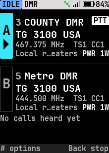
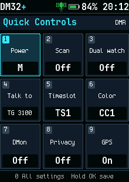

<!-- SPDX-License-Identifier: MIT -->
<!-- Copyright (c) 2026 Garrett Dothard -->

# Keys and menus

Home shows the current channel or VFO, talk target, signal, battery, and clock. Quick Controls and Main Menu use numbered cards.
The footer shows the actions available on the current screen.

## Main controls

| Control | Action |
|---|---|
| **OK** | Open or choose the focused item; on Home, open Main Menu |
| Hold **OK** | Save or make a change permanent where the screen offers it |
| **Back** | Go back; on Home, undo a temporary change |
| Hold **Back** | Return to Home |
| **\*** | Open Quick Controls |
| Hold **\*** | Lock or unlock the keys |
| **#** | Actions for the focused item; on Home, actions for the current or last caller |
| Hold **#** | Open the DMR talk target picker |
| **Up / Down**, channel knob | Move through items; on Home, the knob steps assigned talkgroups when present, otherwise channels or VFO frequency; Up/Down follow their setting |
| Number keys | Open a numbered card, filter a list, or enter a value as the screen indicates |
| **PTT** | Transmit; in a target list, call the focused target |

Side-key roles can be assigned in **Settings > Keys**. Instructions naming Monitor or Talk target refer to the assigned role.
The first two assignable side keys also move focus left and right in Quick Controls.

## Main Menu

| Number | Opens |
|---|---|
| **1** | Radio: Quick Controls and Channels |
| **2** | Messages |
| **3** | Contacts & Talkgroups |
| **4** | Zones / Channels |
| **5** | Scan controls |
| **6** | Activity / Logs: Recent calls |
| **7** | GPS, APRS, and Data |
| **8** | Tools & Utilities |
| **9** | Settings |

Choose the card by number or move the focus and press **OK**. Main Menu numbers differ from the older list-style Hub.

## Mode-specific Quick Controls

FM and DMR offer their own operating controls. P25 uses a fixed nine-action map: Power, Listen, Hold, Talk to,
Recent, Favorites, System, Details, and Bright. [P25 Phase 1](08-p25.md#quick-controls) explains each action
and the receive-only behavior of Listen and Hold. Unavailable actions explain their requirements.

## Temporary changes

Quick Controls changes the current operating state. **Back** on Home clears temporary changes one at a time.
Hold **OK** when the screen offers saving to keep a change in the channel. Check the hint row before saving or deleting.

## Clock and key lock

The clock uses valid GPS or retained hardware time and **Settings > Location > UTC offset**.
It shows `--:--` without valid time. Let GPS acquire a fix to establish time.

Hold **\*** to lock or unlock. **Settings > Privacy > PTT when locked** determines whether the locked radio can transmit.
Screen captures of the implemented pages are available through **Screenshots** in the header.
