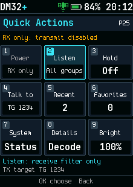
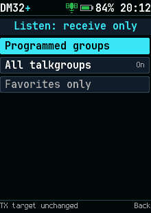
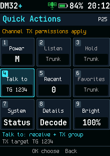
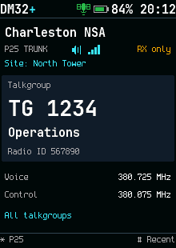
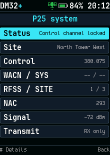
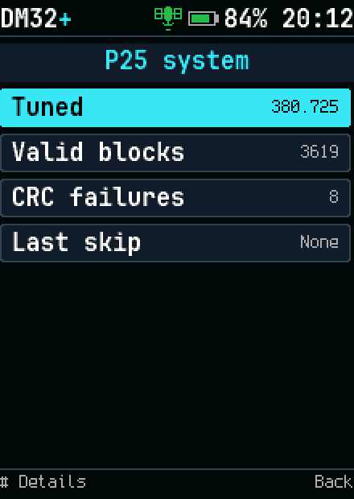

<!-- SPDX-License-Identifier: MIT -->
<!-- Copyright (c) 2026 Garrett Dothard -->

# P25 Phase 1

DM32+ implements conventional and trunked P25 Phase 1 C4FM. Program a stored P25 channel in
[CPS](04-programming.md#p25-programming), then select it on the radio. Phase 2 voice, encrypted P25 voice,
and LSM/CQPSK are unsupported. P25 channels do not participate in Scan or Dual Watch.

Implementation and hardware verification are separate. The [bring-up record](../../../testing/dm32-bringup.md)
and [P25 integration checklist](../../../spec/p25-ui.md#integration-checklist) record the checks performed;
they do not establish interoperability with every live system.

## Receive selection and transmit permission

Keep the channel **RX Only** and its trunked system **Never (listen only)** for passive monitoring.
RX-only trunked channels do not register, affiliate, or request voice service. Transmitting requires both
the channel and system to permit it, plus the normal frequency, busy-channel, battery, and timeout checks.
Choosing a talkgroup never grants that permission.

The channel's assigned talkgroups provide names and ordering. The first assignment is the initial TX target.
On Home, the knob steps through assignments, wrapping at either end; Up/Down still change channels.
With no assignments, the knob changes channels. **Talk to** selects an assignment for both reception and
the TX target. **Listen** and **Hold** change reception only, leaving that target unchanged.

## Quick Controls

From P25 Home, press **\*** to open Quick Controls. Numbers keep the following positions:

| Key | Action | Use |
|---|---|---|
| **1** | Power | Change power when TX is permitted |
| **2** | Listen | Choose Programmed groups, All talkgroups, or Favorites only |
| **3** | Hold | Hold the newest eligible received group; press again to release to Programmed groups |
| **4** | Talk to | Select an assigned group for reception and the TX target |
| **5** | Recent | Browse received calls; **OK** holds and **#** manages favorites |
| **6** | Favorites | Browse and manage this system's saved receive groups |
| **7** | System | Inspect site, decoded identity, permission, and signal |
| **8** | Details | Inspect tuned frequency, decode counters, and Last skip |
| **9** | Bright | Adjust brightness |

Programmed groups restores the channel's filter. **Follow every group of the system** in CPS makes that
programmed behavior follow all supported groups instead of only the assignments. All talkgroups broadens
reception; it does not add support for encrypted or Phase 2 voice. Favorites only needs a saved favorite.
**Back** leaves the Listen picker without changing the filter.

Hold skips private calls when finding the newest eligible group. With no recent group, there is nothing to hold.
RX-only trunked channels retain Listen, Hold, and Favorites. Conventional channels explain **Trunked only**
for those controls; their assigned-group picker, Recent, and diagnostics remain available.

## Recent calls and favorites

Press **#** on P25 Home, or choose **5 Recent**. **OK** holds reception on the selected group;
**#** adds or removes it as a favorite. A star marks a favorite. Each trunked system has four favorite slots.
These actions leave the TX target unchanged.

Favorites survive restarts. Saving one reloads the P25 owner, clearing recent history and temporary selection.
Changing channels or reloading the codeplug also resets selection to the programmed behavior.
A receive-filter change during a voice call applies to later grants; the current call finishes normally.
Release Hold with **3 Hold** again, or select Programmed groups or All talkgroups in Listen.

## Home, sites, and diagnostics

Home shows the group ID, programmed name, and source ID when decoded. **Last heard** identifies a remembered call.
**Tuned** is the current receiver frequency; **Control** is the acquired control channel.
Linked squares indicate acquired control, a speaker indicates a voice grant or reception, and a search symbol
indicates acquisition. A P25 mode label or control lock alone does not prove voice reception or audible audio.

Enter optional site names in CPS **Systems > Sites**, with their broadcast RFSS/site IDs and control-channel
site groups. A site group links programmed controls to a site; it is separate from the broadcast identity.
Home retains a confirmed site name while following voice. Unnamed sites show numeric RFSS/site IDs.
**Candidate** means acquisition is in progress. **Site mismatch** means the decoded identity conflicts with
the configuration; review the system, site IDs, and control frequencies.

System shows the full name, identity, and signal strength. Unknown identity fields show `--`.
**#** switches between identity and decoding details. **Last skip** records the last refused call, such as
encryption, Phase 2, or a missing channel identifier plan. It is not necessarily a current fault.
For connection and programming errors, see [Troubleshooting](20-troubleshooting.md#p25-does-not-follow-calls).
