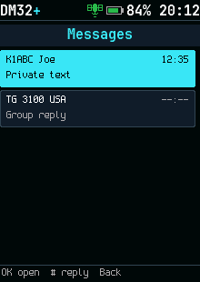
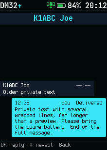
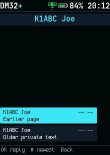

<!-- SPDX-License-Identifier: MIT -->
<!-- Copyright (c) 2026 Garrett Dothard -->

# Messages

Messages, call alert, and radio check use DMR data. Set your DMR ID and select a DMR channel you can transmit on.
These data services do not require the voice codec.

## Conversations

Open **Main Menu > Messages** (**OK**, **2** from Home). The newest conversation appears first.
Select one to read the full incoming and outgoing messages. Press **OK** in a conversation to compose a reply.
Private-message replies address the sender; group-message replies address the talkgroup.

The current firmware includes persistent message history. Stored incoming and outgoing messages survive a restart;
outgoing entries include the send result. Times use GPS or valid hardware time and the saved UTC offset.
Entries without a captured time show `--:--`. The archive stores message text in plaintext.

A received-message banner can be opened with **#** while it is visible. Live inbox storage is separate from the archive
and holds only the latest messages in memory. If history is unavailable, that inbox is cleared when power is removed.

## Write and send

Open a conversation and press **OK**, or choose **Message** in a contact's actions. Select a canned reply or **Write...**.
Press a number key repeatedly to cycle through letters. **#** changes letter case or selects digits;
**Back** deletes a character and leaves when the draft is empty. **OK** sends up to 140 characters.

| Result | Meaning |
|---|---|
| Delivered to | The recipient radio acknowledged the message |
| Sent to | The message was transmitted; group messages have no recipient confirmation |
| No answer / Not delivered | No confirmation arrived; check the channel, ID, and format before sending again |

A receiving radio can display a message even when its acknowledgment does not reach the sender.

## Message format

**Settings > Connections > Message format** selects ETSI, ETSI short, or Motorola text for outgoing messages.
The radio can receive the supported formats independently of this setting. A reply uses the incoming message's format.
Match the destination system when troubleshooting delivery.

## Call alert and radio check

Use the destination's actions to send a call alert or check whether a radio answers.
A call alert asks the recipient to respond. Radio check tests a data response; it does not establish a voice call.
No response can mean an unavailable radio, mismatched channel parameters, or an unsupported service.
