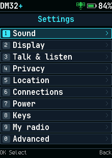
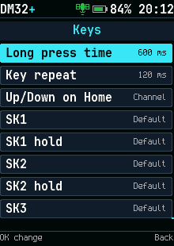
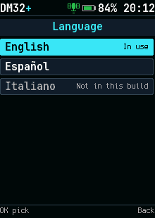

<!-- SPDX-License-Identifier: MIT -->
<!-- Copyright (c) 2026 Garrett Dothard -->

# Settings

Open **Main Menu > Settings** (**OK**, **9** from Home). Choose a category, select a setting, and follow its footer hint
to change the value. Settings are saved on the radio. Some codeplug values can also be edited in CPS.

## Categories

| Category | Main controls |
|---|---|
| Sound | Key and message tones and audio feedback |
| Display | Brightness, backlight, theme/highlight color, text size, and language |
| Talk & listen | Reply window, TX timeout, squelch, VFO step, microphone options, and dual-watch behavior |
| Privacy | Basic privacy, auto lock, and whether PTT works while locked |
| Location | GPS, UTC offset, and whether the radio answers location requests |
| Connections | Hotspot permission and DMR message/data settings |
| Power | Battery-saving and power behavior |
| Keys | Side-key roles and Up/Down behavior on Home |
| My radio | Your DMR ID, radio name, and boot text |
| Advanced | About, diagnostics, frequency trim, crash log, and reset |

Only settings available in the running build can be changed. A dimmed setting can also depend on the current mode.
Microphone processing and advanced RF features have hardware verification limits; see the
[bring-up record](../../../testing/dm32-bringup.md) rather than treating a menu entry as proof of an on-air test.

## Keys

Assign side-key roles under **Keys** and check them after importing a codeplug. Up/Down on Home can move through
channels, zones, or talk targets; the channel knob remains a channel control.
See [Keys and menus](05-keys-and-navigation.md) for the current card-menu shortcuts.

## Display and accessibility

Use **Display** for text size, brightness, backlight behavior, theme/highlight color, and language.
English is the fallback for a missing translation. Spanish and Italian catalogs exist; the languages available
on the radio depend on the selected firmware build. A dimmed language requires a build that includes it.
Sound feedback and key assignments can also help adapt operation. Preview the current screen and footer hints
after changing text size or language. Site language and radio language are separate choices.

## Clock and messages

Set **Location > UTC offset** in 15-minute steps. GPS or valid retained hardware time supplies the clock.
The offset affects Home and message times; it does not convert an unknown time into a valid one.

## Encryption

Basic privacy is configured under **Privacy**. Persistent AES keys and their slot assignments are managed in
[CPS Encryption](04-programming.md#encryption-slots). Exported codeplugs do not back up AES key values.

## About and diagnostics

**Advanced > About** shows the installed version. Use this version in reports.
Diagnostics helps inspect the running radio. Frequency trim changes calibration-related operating behavior;
leave it alone unless you are making a measured adjustment.

## Crash log

If the radio restarts unexpectedly, open **Advanced > Crash log** and record the displayed details.
The debug tool can collect a fuller report. Include the actions that preceded the restart.

## Factory reset

Read the confirmation screen before accepting a reset. It resets saved settings and is not a way to restore the stock firmware.
Save a codeplug and keep your encryption keys separately before recovery work.
