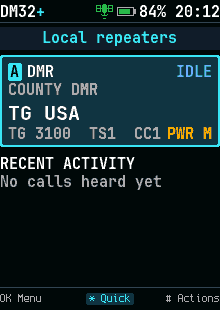

<!-- SPDX-License-Identifier: MIT -->
<!-- Copyright (c) 2026 Garrett Dothard -->

# DM32+ firmware guide

This guide covers the DM32+ release for the Baofeng DM-32UV: its card menus, CPS, firmware installer, and programming cable.
Use **Install** in the header for firmware and **CPS** for channels, contacts, and settings stored in the codeplug.

## Get started

1. [Install or update](02-installing.md): release channels, backups, the codec, and recovery.
2. [Program with CPS](04-programming.md): read the radio, edit files, write changes, and manage encryption slots.
3. [Keys and menus](05-keys-and-navigation.md): Home, Quick Controls, Main Menu, and shortcuts.

## Use the firmware

- [Channels, calls, and scanning](07-channels-zones-vfo.md): FM, DMR, VFO, zones, talkgroups, scan, and dual watch.
- [Messages](10-messages-and-signaling.md): conversations, replies, delivery results, call alert, and radio check.
- [GPS, APRS, and data](13-aprs.md): position, beacons, ARS, and LRRP.
- [Hotspot and host connections](14-hotspot.md): the programming cable, DMR modem mode, and serial networking.
- [Settings](17-settings.md): display, sound, clock, keys, privacy, power, and diagnostics.
- [Troubleshooting](20-troubleshooting.md): connection errors, missing audio, recovery, and reporting a problem.

## Firmware scope

The host connection uses the USB-to-serial **programming cable**. The radio does not provide a native USB data connection.
USB network adapter mode and DFU/Zadig driver instructions do not apply to this release.
Custom selections use this project's build service; the original upstream build service is not used.
VOX is not available in the current board implementation. Air band AM and broadcast FM receive are included,
but their on-air verification is not recorded in the feature matrix.

Features present in a build are not all verified on air. The [bring-up record](../../../testing/dm32-bringup.md)
records hardware checks and remaining work. The [shared specifications](../../../spec/README.md) remain in the
source repository for contributors; they describe more hardware and configurations than this product guide.

## Support

Use [this project's issues](https://github.com/gjdothard/DM32Plus/issues) for questions, bug reports, and feature requests.
Include the firmware version and steps to reproduce a problem. See [Troubleshooting](20-troubleshooting.md#reporting-a-problem)
for collecting an error report.
