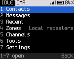
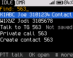
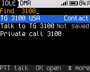
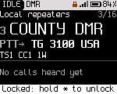

<!-- SPDX-License-Identifier: MIT -->
<!-- Copyright (c) 2026 Garrett Dothard -->

# Keys and Navigation

Each key does the same kind of thing on every screen.

## The five rules

1. **OK** opens or chooses the thing with the focus. Holding **OK** does the lasting version, such as save or make
   permanent.
2. **Back** goes back one level. On Home it undoes one temporary change per press. Holding **Back** returns to Home
   from anywhere.
3. **\*** opens quick settings for what you are doing. Holding **\*** locks or unlocks the keys.

On displays with the card layout, **Quick Controls** shows nine numbered tiles for the current mode.
The cyan outline marks the focused tile and turns amber while editing a value. Use the corresponding
number key to open a tile directly. The first two assignable side keys move focus left and right in
Quick Controls on radios with that key pair. On an FM memory channel, the Offset tile shows the stored split.
Use the VFO's TX frequency control to edit a split while operating in VFO.
4. **#** opens the actions for the thing with the focus, such as a person, a talkgroup, a message or the last caller.
   Holding **#** opens Recent.
5. **PTT** talks to the person or talkgroup with the focus in any list, once. With nothing focused, it talks to the
   channel's talk target.

The bottom line of most screens is the hint row. It shows what the nearest keys do there. What **Back** does is at
its right end, above the **Back** key.

## Key reference

The keys are named by their job ([Conventions](01-introduction.md#conventions-in-this-manual)).
[Key roles](23-radios.md#key-roles) lists which physical key does each job on your radio. It also lists what replaces
a key the radio doesn't have.

| Key | Press | Hold |
|---|---|---|
| **OK** | Home: open the hub. Lists: open or choose | Save or make permanent |
| **Back** | Back one level. Home: undo one temporary change | Home |
| **Up**, **Down** | Move the focus. Home: next or previous channel (VFO: frequency step), or zone or talk target with **Settings > Keys > Up/Down on Home** (the channel knob stays on the channel). Editors: change the value | Repeats |
| **\*** | Quick settings. While you transmit on FM with **PTT**: its [touch tone](08-fm.md#touch-tones-dtmf) | Lock or unlock the keys |
| **#** | While you transmit on FM with **PTT**: its [touch tone](08-fm.md#touch-tones-dtmf). Otherwise: actions for the focused item. Home: actions for the last caller. VFO: tunes a frequency being typed, as **OK** | DMR channels: the talk target picker (pick a talkgroup, or type an ID). Recent is **OK**, **3** |
| **0** to **9** | Home: start Find. Lists: pick a numbered row, or type to filter. VFO: type a frequency. While you transmit with **PTT**: FM sends the key's [touch tone](08-fm.md#touch-tones-dtmf), DMR nothing | Home: speed dial (not built yet). While you transmit with **PTT**: as a press |
| **Previous zone**, **Next zone** | Home: previous or next zone | |
| **Monitor** | FM: opens the squelch while held. DMR: digital monitor (every talkgroup) on or off | |
| **Talk target** | Talk target picker (DMR channels) | Dual watch on or off |
| **Power level** | Home: next power level | Hold 1.5 s: emergency ([Emergency](11-emergency.md)) |
| **PTT** | Transmit | |
| Channel knob | Each click is one step. Clockwise: the next channel on Home (as **Up**), the next row down in a list or menu, a higher value in an editor. Counterclockwise: the opposite | |

The side keys (**Monitor**, **Talk target** and **Power level** on most radios) can do other jobs. Set them in
**Settings > Keys** ([Settings](17-settings.md#keys-key-8)) or in the codeplug.

Each key press gives a short key beep unless **Settings > Sound > Key tones** is off.

While the keys are locked (hold **\***), **PTT** still works. When **Settings > Privacy > PTT when locked** is off,
**PTT** gives an error beep and "PTT is off while locked: hold * to unlock".

## Moving around

The Home screen is the base. Every other screen is at most three levels away from it.

```
Home
 |-- *            Quick settings
 |-- OK           Hub: 1 Contacts, 2 Messages, 3 Recent, 4 Zones, 5 Channels, 6 Tools, 7 Settings
 |                    (a radio without # gets 0 Last caller at the top)
 |-- #            Actions for the last caller
 |-- hold #       Talk target picker (DMR)
 |-- 0-9          Find
 '-- Talk target  Talk target picker
```

In numbered lists (the menu, Tools, Settings, actions, quick settings), a number key opens the corresponding row.
On the dark card layout, **#** on Home opens numbered action cards for the current or last caller.
The caller stays in the title. Use a number key, or move the focus and press **OK**. **PTT** talks to the focused
target, and **Back** returns Home.
On the standard Hub, **OK**, **6** opens Tools. On the dark card layout, **OK** opens the Main Menu:

| Key | Opens |
|---|---|
| **1** | Radio, with Quick Controls and the complete Channels list |
| **2** | Messages |
| **3** | Contacts |
| **4** | Zones / Channels |
| **5** | Scan controls. Select **Start scan** to begin |
| **6** | Activity / Logs, which opens Recent calls |
| **7** | GPS / APRS, with Position and APRS |
| **8** | Tools & Utilities |
| **9** | Settings |

On the card layout, **Activity / Logs** shows callers as cards, with their call direction, target, and age.
**PTT** talks to the focused call's target. **#** opens its actions.

The 24-hour clock is to the right of the battery percentage on the tall branded display. It uses fresh GPS time or a valid hardware
clock, with the saved **Settings > Location > UTC offset**. On a radio with RTC support, let GPS acquire a fix once
so the hardware clock can keep time when GPS is unavailable. The display shows `--:--` when neither source has valid time.
See the [feature matrix](../feature-matrix.md) for which radios have RTC support.


In long lists (Contacts, Channels, a zone's channels) the number keys filter the list by name, the way a phone
keypad spells words. **2** is ABC, **3** is DEF, and so on to **9** (WXYZ). Each key narrows the list to names with a
word that starts with those letters. **Back** deletes the last key typed, then leaves the list.



## Find

On Home (not in the VFO), a number key opens Find. Find searches everything at once. Type digits. Find lists, in
this order:

1. The channel at that position in the current zone. "12" lists channel 12.
2. The digits as a frequency in one of the radio's bands, read as in the VFO: "461462" lists "Tune VFO to 461.462".
   **OK** opens the VFO on it. The VFO's mode, power and tones stay as they were.
3. Channels in the zone, contacts and talkgroups, zones, places (Contacts, Messages and so on) and settings whose
   names match the keys as letters.
4. Contacts whose DMR ID starts with the number, from three digits on.
5. The number itself, as a talkgroup ("Talk to TG 3100", "not saved") and as a private call ("Private call 3100").
6. "Create contact 3100" when no contact has that ID. **OK** opens New Contact ([Contacts](09-dmr.md#contacts)).

Then:

| Key | Does |
|---|---|
| **OK** | Go to the channel or zone, tune the VFO, open the place or setting, talk to the talkgroup or person for now, or create the contact |
| **PTT** | Talk to the focused talkgroup or person once |
| **#** | Actions for the focused talkgroup or person |
| **Back** | Delete the last digit. With one digit left, leave Find |

Settings also answer to other names. For example, "promiscuous" finds Digital monitor and "TOT" finds TX timeout.




## Temporary and permanent changes

Changes you make while operating (power, squelch, tone, timeslot, color code, mode, talk target) are temporary. They
last until you change the channel or press **Back** on Home. Home marks the changed fields. To keep a change in the
channel, hold **OK** on Home or in quick settings. The radio shows "Saved to channel".
In the VFO, changes are kept automatically, so a hold says "VFO settings save automatically". If another
write is in progress, it says "Save busy: try again"; wait a moment and hold **OK** again.

**Back** on Home clears one thing per press, in this order:

1. a frequency being typed
2. a banner
3. the scan
4. the reply window
5. digital monitor
6. all temporary changes together ("Changes undone")

## Key lock

On Home, hold **\*** to lock the keys. The screen shows "Keys locked: hold * to unlock" and an "L" in the status line.
While locked, **PTT** and **Monitor** still work. Any other key shows the unlock hint. Hold **\*** again to unlock.
In menus holding **\*** doesn't lock, so a slow press can't lock the keys in the middle of a task.

**Settings > Privacy > Auto lock** locks the keys by itself after a time without a key press.



## Toasts and banners

Short messages ("toasts") appear in the hint row for about two seconds. A toast shows the result of an action, or why
something isn't available. A long toast takes a second line above the hint row and isn't cut short. Banners announce
events (a message, a call alert, a radio check result) for eight seconds. While a
banner about a message or a call alert is up, **#** opens what it is about. **Back** on Home hides it.
