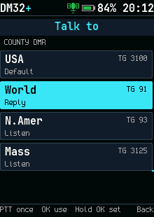
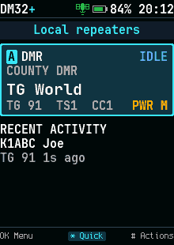
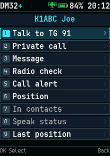
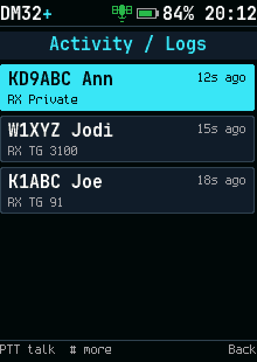
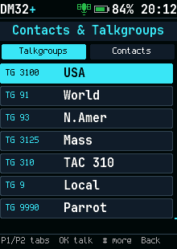
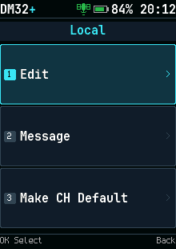
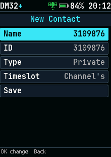
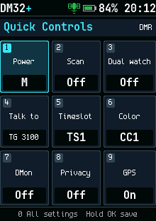
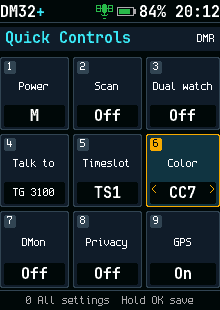

<!-- SPDX-License-Identifier: MIT -->
<!-- Copyright (c) 2026 Garrett Dothard -->

# DMR

The [Radio reference](23-radios.md) says which radios have DMR verified. DMR voice needs the codec
([Installing](02-installing.md)) and a DMR ID in the codeplug.

## Terms

| Term | Meaning |
|---|---|
| Talkgroup (TG) | A DMR group number with an optional name |
| Contact | A person: DMR ID, name, callsign |
| Talk target | Where **PTT** goes now: a talkgroup, a person, or all call |
| Listen list | The talkgroups a channel listens to (the codeplug's RX group list) |
| Recent | Stations heard and calls made, newest first |
| Digital monitor | Play every talkgroup on this timeslot (promiscuous mode) |
| Timeslot (TS) | One of the two time slots of a DMR channel |
| Color code (CC) | A number from 0 to 15 that a DMR channel uses, like a tone on FM |

## Who you hear

The radio plays a group call when one of these is true:

- its talkgroup is the talk target's talkgroup, or the call is an all call;
- its talkgroup is in the channel's listen list;
- it is the reply target during the reply window ([below](#replying));
- digital monitor is on.

The radio plays a private call addressed to your DMR ID. It shows every other call on the slot as "Other TG: not
played" and treats the channel as busy while it lasts.

Echo or parrot services may return your recording with your own DMR ID as the source. Once your transmission
has finished, the radio plays that reply using the same talkgroup and private-call rules as any other caller.
Digital monitor can also play it. Use the service's required talkgroup, call type and timeslot.

## Who you talk to

**PTT** sends to, in this order:

1. The talkgroup or person with the focus in a list, once (one-shot).
2. The reply target, while the reply window runs.
3. A talk target chosen for now.
4. The channel's talk target from the codeplug. A channel without one talks to the first talkgroup of its RX group
   list, and uses talkgroup 9 only when it has no list either.

Home shows the result after "PTT→".

## Choosing a talk target

On a DMR memory channel with **Operating talkgroups** assigned, turn the channel knob
to cycle through those entries and press Up or Down to change channels. Each entry supplies the timeslot and
talkgroup together. The first entry is the default. The repeater frequencies, color code, power, and privacy
settings come from the channel. The RX Group List still controls which additional talkgroups you hear.
In the web CPS, open a DMR channel and select **Operating talkgroups**. Use **Add talkgroups** to find and assign
saved groups, or **Create talkgroup** to add a new contact and assign it together. Use **Move up** and
**Move down** to set the knob order. **Save channel** applies the edit to your codeplug.

In the web CPS, choose **Channels > Convert Operating Talkgroups** to prepare a legacy codeplug for
firmware with shared talkgroup support. Review the assignment and contact counts before confirming.
You can undo the conversion in the editor before writing the codeplug to the radio.

With a converted codeplug, open a saved DMR channel in the channel editor and select **Operating talkgroups**.
Select **Add talkgroup** to choose a saved group contact. Select an existing assignment to move it up, move it down,
or remove it from this channel. Edits save individually. You can also edit the list in the Codeplug Editor.
Each channel holds up to 63 assignments, subject to shared space. Each contact uses its own timeslot override
when set. Otherwise, it follows the channel's timeslot.

Use **Add talkgroup** or **Add contact** from the corresponding directory tab. For a saved entry, press **# More**
and choose **Edit** to change its name or number. **TS** sets a talkgroup's timeslot override. Saved assignments
follow edits to their group contact. **Make CH Default** sets the saved channel's TX contact.

Hold **#** on a DMR channel to open the talk target picker: the channel's default, the reply target, the RX group
list's talkgroups, recent talkgroups, and "Type a number..." to dial an ID or talkgroup by hand. The **Talk target**
side key opens the same picker.

A talk target has three lifetimes.

| Lifetime | How | Lasts |
|---|---|---|
| Once | Focus a talkgroup or person in any list (Contacts, Recent, Find, the picker, actions) and press **PTT** | This call and its reply window |
| For now | Focus it and press **OK**. The radio shows "Talking to ..." | Until you change the channel or press **Back** on Home |
| Permanent | Focus it and hold **OK**. The radio shows "... is the default now" | Written to the channel |

A permanent talk target must be a contact in the codeplug. A typed number is used for now only. The radio shows
"Not a stored contact: for now only".

### The talk target picker

Press **Talk target** on a DMR channel or open **Talk to** under **\*** (**4** on the Memory card grid,
**8** on the standard grid). On a channel with operating talkgroups, the **Talk to** tile opens the
assigned entries with their timeslots. Press **OK** to select one. Both the tile and picker show
all seven digits, and the picker shortens a long name at the end to keep the ID visible.

The general talk target picker lists, in order:

| Row | Tag |
|---|---|
| The channel's talk target | default |
| The last call heard: its talkgroup, or the caller for a private call | reply |
| The talkgroups of the channel's listen list | listen |
| Talkgroups from Recent | recent |
| Type a number... | |

The focus starts on the reply row when there is one.

| Key | Does with the focused row |
|---|---|
| **PTT** | Talks to it once |
| **OK** | Uses it for now |
| Hold **OK** | Makes it the channel's default |
| **#** | Opens its actions |

"Type a number..." opens Find. Type the talkgroup or ID, focus the line you want and press **PTT** or **OK**.



On an FM channel **Talk target** shows "Talk target: DMR channels only".

### Typing a talkgroup or ID

On Home, type the number. Find lists "Talk to TG 3100" and "Private call 3100" (with a name when the ID is a contact).
Focus one and press **PTT** for one call, or **OK** for now.

## Replying

After a call the radio played, the reply window opens. During the window **PTT** answers the call. A group call is
answered on the same talkgroup, a private call to the caller. After your own call, **PTT** goes to the same target again. Home shows "Reply→" with
the target and a countdown.



The window lasts as long as **Settings > Talk & listen > Reply window** says (0 to 30 s). 0 turns it off. When that
setting is left at its start value, the codeplug's hang time applies. Without a hang time in the codeplug, the window
lasts 10 s. **Back** on Home ends the
window ("Reply ended").

## Calling back later

On Home, **#** opens the actions for the current or last caller. A digit picks an action.



| # | Action | What it does |
|---|---|---|
| 1 | Talk to | Talks to the talkgroup they were heard on, for now. After a private call, talks to them. **PTT** on this row talks once |
| 2 | Private call | Calls them privately, for now. **PTT** on this row calls them once |
| 3 | Message | Opens the message composer ([Messages](10-messages-and-signaling.md)) |
| 4 | Radio check | Checks that their radio is on and in range |
| 5 | Call alert | Pages their radio |
| 6 | Position | Requests the person's GPS position over LRRP when available ([location](10-messages-and-signaling.md#registration-ars-and-location-lrrp)) |
| 7 | Save as contact | Opens New Contact with their ID and name ([Contacts](#contacts)). "In contacts" when they are one |
| 8 | Speak status | Not built yet |
| 9 | Last position | Shows the last received position when this feature is built |
| Next available number | Save to channel | Shown only when the channel has temporary changes; follows Last position when present |

For a talkgroup the actions are Talk to, Make channel default and Message, and 4 Save as contact when it isn't a contact.

Without anyone heard yet, **#** shows "No calls heard yet".

## Recent

Open **Activity / Logs** with **OK**, **6** on the card Main Menu, or Recent with **OK**, **3** on the standard Hub.
Recent lists the last 12 stations heard and calls made, newest first. Calls you made
start with an arrow. Calls to you are highlighted, and private calls show "you" or "priv". Recent is kept in memory
and starts empty after a restart.



**PTT** talks to the focused entry (the talkgroup a station was heard on). **OK** uses it for now. Holding **OK** makes
it permanent. **#** opens its actions.

## Contacts

**OK**, **1** on the standard Hub lists the codeplug's contacts and talkgroups. On the card layout,
**OK**, **3** opens **Contacts & Talkgroups**. Use the first or second assignable side key to switch
between **Talkgroups** and **Contacts**. **TG** marks group calls and **PC** marks private calls.
Type letters of the name or digits of the ID to filter the current tab.
**OK** talks to the focused entry for now. Holding **OK** makes it the channel's default. **PTT** talks to it once.
**#** opens its actions.




### New contact

Make a contact on the radio from a number or a call:

- On Home, type the ID or talkgroup. Find's last row is "Create contact 3100" when no contact has that number. Press
  **OK**. Up to 6 digits start as a talkgroup, 7 and more as a person.
- In a caller's or talkgroup's actions (**#**), pick **Save as contact**.



| Row | **OK** does |
|---|---|
| Name | Type the name with the keypad ([text entry](07-channels-zones-vfo.md#text-entry)) |
| ID | Type the ID. **Back** takes back a digit, **OK** keeps it |
| Type | Talkgroup or Private |
| Timeslot | Channel's, TS 1 or TS 2 |
| Save | Saves it. Holding **OK** on any row saves too |

The radio refuses a duplicate private ID or an identical talkgroup ID and timeslot override. Read the codeplug into
the CPS before editing it there so it includes the contacts changed on the radio.

## Private calls

- From a contact: open **Contacts**, find the person, press **#**, **2** (Private call), then **PTT**. Or focus the person and
  press **PTT**.
- By ID: type the ID on Home, focus "Private call ..." and press **PTT**.
- To answer a private call, press **PTT** during the reply window.

While you talk, the top line says "Private" and the screen shows the contact's name
([Transmitting](06-home-screen.md#transmitting)).

## Timeslot and color code

On a DMR channel, **\*** opens these tiles:

On the Memory card grid, the keys are **1** Power, **2** Scan, **3** Dual watch, **4** Talk to,
**5** Timeslot, **6** Color, **7** Digital monitor, **8** Privacy, and **9** GPS. **0** opens Settings.



The standard grid and VFO use the following key positions.


| Key | Tile | What it does |
|---|---|---|
| **1** | Power | Steps through the radio's lowest level, its default and its highest ([power levels](16-battery-and-power.md#transmit-power)) |
| **2** | Slot | Switches between timeslot 1 and 2, for now |
| **3** | Color | Opens the color code editor |
| **4** | Copy to VFO / Mode | Copies a Memory channel to the VFO. In VFO, switches between FM and DMR when both modes are available |
| **5** | DMon | Digital monitor on or off |
| **6** | Privacy | Privacy on or off. In the VFO this tile is TX freq ([Split](07-channels-zones-vfo.md#split-repeater-offset)) |
| **7** | Dual | Dual watch on or off |
| **8** | Talk to | Opens the talk target picker |
| **9** | Bright | Opens the brightness editor |
| **0** | | Opens Settings |

To change the color code, press **\*** and select **Color** (**6** on the Memory card grid, **3** on the standard grid).
Press **Up** or **Down**, or type the code (0 to 15). Press **OK** to
apply it. The new
color code takes effect when the editor closes.



Timeslot and color code are temporary. They can't be changed while transmitting. Hold **OK**
to save them to the channel. In the VFO they are the VFO's own settings and are kept ([the VFO](07-channels-zones-vfo.md#dmr-in-the-vfo)).

## Waking a repeater

A repeater that is idle may need a wake-up before it carries your call. On a repeater channel (TX and RX frequencies
differ) the radio sends the wake-up when you press **PTT** and then waits for the repeater to answer. A short press is
enough: let go of **PTT** and the radio keeps trying, up to the usual number of attempts.

| What you hear | Meaning |
|---|---|
| The talk permit tone (if it is on) | The repeater answered. If you were still holding **PTT**, the call starts. If not, nothing more is sent, and you can press **PTT** again |
| The low error tone | No repeater answered. Check the color code and your range |

## Digital monitor

Digital monitor plays every talkgroup on this frequency, timeslot and color code.

- Press **Monitor** on a DMR channel (a short press; it acts when you let go). The radio shows "Digital monitor on" and
  the chips show "DMon". Press it again to turn it off. On an FM channel the same key opens the squelch while you hold it.
- Or use the **Digital monitor** quick tile (**7** on the Memory card grid, **5** on the standard grid).

Digital monitor stays on until you turn it off, change the channel or the mode, or press **Back** on Home. While it
is on, the reply window lets you answer any call you heard with **PTT**.

## Privacy

An encrypted call must carry privacy indicators in both its call header and its voice bursts. A network label
alone does not verify encryption. Check that a receiving radio with the matching key can decode the voice.

RadioFoundry has two kinds of basic privacy: Motorola basic privacy (keys 1 to 255) and Anytone 16-bit basic privacy. Basic
privacy is a fixed scrambling of the voice. It keeps casual listeners out but isn't encryption. The scrambling hasn't
been checked against another radio yet ([Radio reference](23-radios.md)).

- The radio plays an encrypted call only when it has the matching key. Without the key the call shows as
  "Encrypted: not played".
- A build with basic privacy only skips calls that require a stronger encryption mode. See the AES-256 section
  below for builds that support it.
- The **Privacy** quick tile switches basic privacy on for your calls (**8** on the Memory card grid, **6** on the
  standard Memory grid). Home shows "Priv" or the yellow **PRIVACY** badge. An active **AES-256** binding is shown on
  the Memory card grid's Privacy tile and is managed in the codeplug. **Back** on Home turns temporary basic privacy off.

To set a basic privacy key on the radio, open **Settings > Privacy** (**OK**, **9**, **4** on the card
Main Menu; **OK**, **7**, **4** on the standard Hub).

1. On **Key type**, press **OK** until it shows Motorola or Anytone.
2. On **Key**, press **OK**. Type the key in decimal with the number keys (Motorola 1 to 255, Anytone 0 to 65535).
   Press **OK** again.

The radio keeps the basic privacy key in its settings across restarts. Setting the type back to Off removes it.
Key values are separate from the codeplug; persistent AES slots are managed through the CPS below.
Developers can also load a basic privacy key over the host link with the debug tool:

```
tools/rfoundry_debug.py radio privacy moto 5          # Motorola basic privacy, key 5
tools/rfoundry_debug.py radio privacy anytone 4660    # Anytone basic privacy, key 4660
tools/rfoundry_debug.py radio privacy off
```

AES-256 voice is available in builds with `CONFIG_DMR_AES256`. It uses the AES-256/OFB format described in
[the voice specification](../spec/dmr-voice.md#51-aes-256-sessions). Two-way compatibility with stock radios is
still untested; an AES label alone does not guarantee compatible signaling.

For a temporary RAM-only AES key, use the debug tool. Select a DMR channel and wait until the radio is idle. Put the
32-byte key in a local file as 64 hexadecimal characters, then run:

```
python3 tools/rfoundry_debug.py --port COM_PORT radio aes256 7 KEY_FILE
python3 tools/rfoundry_debug.py --port COM_PORT view --section dmr
```

Replace `COM_PORT` and `KEY_FILE` with your port and key file. Use the same key and key ID on the other radio.
The tool checks that the radio is idle and waits for confirmation that the key was applied. The view then shows
`dmr.aes_key_id=7` and `dmr.privacy=1`. It does not press PTT. Keys remain in RAM only, disappear on restart, and are removed by
`radio privacy off` or by selecting basic privacy. The Settings privacy editor stores basic privacy keys only.

For keys that survive a restart, use the web CPS **Encryption** tab. Connect with the radio idle, choose a slot,
enter key ID 1-255 and exactly 64 hexadecimal characters, or choose **Generate random key**.
The generator uses the browser's cryptographic random source to create 32 bytes locally. Copy the key
for your other radios before saving it. Programmed slots show **Key programmed**; **Change key** asks
for confirmation before opening the replacement editor. Key values entered in the editor can be shown
or copied. Selecting a different slot, refreshing status, or leaving the tab clears the entry. Key values stay out of codeplug exports
and browser drafts; they are stored in ordinary radio flash. Deletion does not securely erase old flash records.

To assign a key, open **Channels**, edit a DMR channel, and set **Encryption** to its key slot. Save the channel,
then **Write to Radio**. Assign **Off on this channel** for clear voice, or **Radio default** to inherit the
Encryption tab's **Radio default** selection. Keys, the default and channel assignments survive restart.
An empty, unreadable or exhausted assigned slot blocks voice TX and shows an encryption-key warning.

Existing channels inherit the radio default. **Turn default AES off** affects those channels; explicit channel
assignments still apply. The radio's Settings privacy editor remains for basic privacy on inherited channels.
Use current firmware: older versions cannot enforce channel assignments. The web CPS checks this before writing.
Binary codeplugs and CSV retain assignments; YAML export warns that it omits them. Key values are never exported.

Run the web CPS locally with `python3 site/build.py --serve` and open `http://localhost:8000/codeplug/` in a browser
with Web Serial support. No hosted account is needed.

The tool supplies a random 32-bit MI seed. This legacy format has no authentication and only a 32-bit MI; use
fresh keys across sessions and avoid sharing a transmit key between several simultaneously transmitting radios.
After about 6.55 hours of encrypted voice, the session refuses further transmissions. For a stored key, select
its slot again to reserve a fresh range. Each boot also reserves a new range. Use a fresh key when its lifetime
allocation is exhausted or after deleting a previously used key.

Without a key, the Privacy tile shows "No privacy key: set one in Settings > Privacy". The keys are stored without
protection in the radio's flash.

## Position in calls

Some DMR radios send their position inside a voice call (ETSI GPS Info). When a caller does, the receive screen shows
how far away it is and in which direction, for example "12.3 km NE". When the radio doesn't know your own position,
it shows the caller's coordinates. Recent keeps the distance with the call.

Your own position goes into your calls when **Tools > APRS > Position in DMR calls** is on (off by default) and the
radio knows where it is (see [APRS](13-aprs.md#position)). Every other superframe carries it, taking turns with your
talker alias.

## Talker alias

The receive screen shows the talker alias other radios send, as it arrives. **Settings > Talk & listen > Show talker
alias** turns this off. The radio sends your callsign from the codeplug (8 characters) as your own alias when the
channel's talker alias setting in the codeplug asks for it.

## Roaming

On a system of DMR repeaters that carry the same talkgroups at different sites, the radio can move to a better
repeater by itself when the one it's on gets weak. You turn roaming on per zone.

1. Put the repeater channels of one system in a zone, each set to the same contact.
2. Pick one of them, then open **Tools > Roaming** and turn on **Roam in this zone**.

While idle, the radio watches the signal of the repeater it's on. When the signal stays below the threshold, the radio
listens to the zone's other sites and moves to the strongest one it can hear. It never moves during a call, a scan or
hotspot use, while you transmit, or in the 3 seconds after a call ends, when a reply may come. Home shows `Roam` next
to the repeater chip, or an amber `Roam?` when the current site is weak. The status strip shows `ROAM` during a search.
A toast says "Moved to" and the new channel's name.

| Row | Does |
|---|---|
| Roam in this zone | Turns roaming on or off for the current zone |
| Roam now | Searches the sites at once |
| Lock to this site | Stays on the current repeater until you unlock (Home shows `Lock`) |
| Site survey | How the repeaters' beacons line up: Synced (default), Per site, or Off |
| Beacon interval | How often the repeaters beacon: 60 s (default), 2, 5 or 10 min, 10 to 30 s, or None |
| Beacon length | How long each beacon lasts: 1 to 10 s (4 s by default) |
| Wake probe | On: the radio briefly keys up a quiet repeater to measure it. This transmits. Off by default |

Many repeater systems make every repeater transmit briefly while idle. This is a "beacon", for example 4 s every
minute, all at the same moment. The radio learns when its repeater's beacons come. During each beacon it hops to a few of
the other sites for under a second each, measures them and comes back. The screens keep showing your repeater. A key
press, **PTT** or a call on the visited site brings it straight back. A call that starts on your repeater while the
radio is away is joined up to about 3 s late, so the radio skips the survey for a while after traffic. When your
repeater gets weak, the radio checks the best site it measured at the next beacon and moves there, usually within a
minute. Set **Beacon interval** and **Beacon length** to match the system (ask its operator). If each repeater beacons
on its own schedule, pick **Per site**. If they don't beacon, pick **None**: the radio then relies on calls it hears.
The screen says "Beacons: learning" until the radio knows the schedule, then "Beacons: surveying".

A site is a repeater channel in the zone (TX and RX frequencies differ) with the same contact as the channel you
picked. When any channel in the zone has the codeplug's Roaming flag set, only flagged channels are sites. You need
at least two sites. Changing channel or zone yourself makes the new channel home.

The threshold (default -105 dBm), the hysteresis (6 dB) and the optional periodic search of the other sites are set
over the debug link for now ([dmr-roaming](../spec/dmr-roaming.md) section 5.1). The debug link also sets the idle
beacon that a hotspot running MMDVM SFR can send for roaming radios (`rpt_beacon`, off by default).
