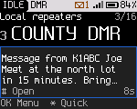
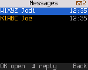
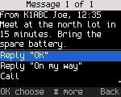
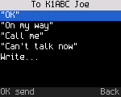
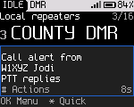
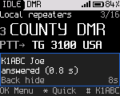

<!-- SPDX-License-Identifier: MIT -->
<!-- Copyright (c) 2026 Garrett Dothard -->

# Messages, Call Alert and Radio Check

Text messages, call alert and radio check work on DMR channels. The [Radio reference](23-radios.md) says which radios
have them verified. None of them needs the codec. Sending needs a DMR channel you may transmit on
and your DMR ID.

## Receiving a message

When a message arrives, the radio shows a banner with the sender and the first words for 8 s. Press **#** while the
banner is up to open the message. The radio plays a short three-note tone with the banner unless **Settings > Sound >
Message tone** is off. On a radio with a vibration motor it also vibrates twice, unless **Settings > Sound > Vibrate**
is off. A call alert or a private call to you gives one long vibration, an emergency four.

After the banner, the status line shows "M" and the number of unread messages, and the hub shows "1 new" next to
Messages.

## Reading messages

1. Press **OK**, **2** (Messages). The newest message is first. Unread messages are highlighted.
2. Focus a message and press **OK**. The radio shows the sender, how long ago it arrived and the text. It marks the
   message read.
3. Below the text:

   | Row | Does |
   |---|---|
   | Reply "OK" | Sends "OK" to the message's reply target |
   | Reply "On my way" | Sends "On my way" to the message's reply target |
   | Call | Temporarily selects the message's reply target for voice |
   | Delete | Deletes the message. There is no undo |

The reply target is the sender for a private message and the destination talkgroup for a group message.
**#** opens actions for that target. **PTT** calls that target from the open message.

The radio keeps the last 4 messages received, in memory. If an open message drops out of the inbox,
the screen reports that the message is gone. The inbox is cleared when the radio turns off.

In builds with the experimental journal, **Settings → Advanced → Message history** prepares the
radio's reserved storage. Select **Enable** to confirm. The radio reports whether it could
activate the reserve. If it reports that blank storage is required, the existing bytes are
preserved. This setting prepares storage for a future conversation archive. Messages currently
continue to use the inbox described above.

## Sending a message

1. Open the actions for the person or talkgroup. Press **#** on Home for the last caller, or **#** on a contact.
2. Press **3** (Message).
3. Pick a text ("OK", "On my way", "Call me" or "Can't talk now"). Press **OK** to send. The texts are sent in the
   radio's language (Settings > Display > Language). To write your own message, select **Write...** instead.
4. In **Write...**, press a digit repeatedly to cycle through its letters. Press **#** to change between uppercase,
   digits, and lowercase. **Back** deletes a character and leaves when the draft is empty. Press **OK** to send
   up to 140 characters. On radios without a numeric keypad, use Up and Down to change the current character,
   **OK** to add another character, and hold **OK** to send.

The radio shows "Sending to ..." and returns to Home. A message to a person asks for a confirmation. When none comes, the radio tries again, in every format. The result
comes as a banner:

| Banner | Meaning |
|---|---|
| "Delivered to ..." | The person's radio confirmed the message |
| "No answer from ...", with "Not delivered: send it again" | No confirmation came. The message isn't kept for a retry. Send it again from the actions |
| "Sent to ..." | A message to a talkgroup has gone out. Talkgroup messages have no confirmation |

With confirmed IP data turned off (`tools/rfoundry_debug.py data ip-settings auto off`), ETSI messages to a person also go
once, with "Sent to".

Messages you send aren't stored in the radio.

## Message formats

**Settings > Connections > Message format** picks the format of the messages you send. The radio reads all three
formats, whatever the setting. A reply goes in the format of the message it answers.

| Format | Use it for |
|---|---|
| ETSI (default) | The standard DMR text message (ETSI IP text). Radios and dispatch software set to "DMR standard" text read it. Delivery to a person is confirmed |
| ETSI short | Radios that only show ETSI short data messages. Delivery is confirmed |
| Motorola | MOTOTRBO radios and dispatch software set to Motorola text messages (TMS). Delivery is confirmed. Not in builds made without Motorola TMS support |

ETSI messages follow the IP header-compression setting: Auto uses compressed headers; Off uses full IP headers.
The recipient may accept one encoding but not the other. Header compression and delivery confirmation are separate:
a text can arrive even when the sender reports no answer. A confirmation means the receiving radio acknowledged it,
not that a person read it.

If your radio was set up before ETSI became the default and its data settings were saved, it keeps sending Motorola
messages until you change the setting.

## Call alert

A call alert pages another radio. It rings there, even when that radio's user isn't listening to your talkgroup.

1. Open the actions for the person (**#** on Home, or **#** on a contact).
2. Press **5** (Call alert). The radio shows "Call alert to ..." and returns to Home.
3. The radio tries up to 3 times. The result is a banner: "... answered the alert" or "No answer from ...".

When someone sends you a call alert, the radio shows "Call alert from ..." with "PTT replies". Press **#** while the
banner is up for the caller's actions. Your radio acknowledges the alert unless **Settings > Connections > Answer call
alerts** is off.

## Radio check

A radio check asks another radio to answer, without its user doing anything. It shows whether that radio is on and in
range. The default request uses Motorola signaling. A matching reply confirms reachability; a failure can also mean
that the other radio does not support or allow this signaling format.

1. Open the actions for the person.
2. Press **4** (Radio check). The radio shows "Checking ...".
3. The radio tries up to 3 times. The result is a banner. "... answered (0.8 s)" gives the round-trip time. "...: no
   answer" comes with "Off, out of range or elsewhere".

Your radio answers radio checks from others while **Settings > Connections > Answer radio checks** is on, the default.
An answer is a short transmission the radio makes without you pressing PTT; turn the setting off if you don't want that.

## Registration (ARS) and location (LRRP)

ARS registers the radio with a presence server at power-up and after a channel change. It is off until a server ID is
set. There is no menu item for it yet. Developers set it over the debug link.

Choose **Position** in the action menu for a private contact to request its current GPS coordinates over DMR.
The target radio needs to support LRRP and have **Settings > Location > Answer GPS requests** enabled if it
runs RadioFoundry. A radio without a GPS fix reports **No GPS fix**. The requester displays **No answer**
if it receives no matching reply. **Position in DMR calls** can stay off.

Open **Last position** in a private contact's actions to see the last position received from that DMR ID.
Successful position replies and GPS reports embedded in received DMR voice calls update the same entry.
The page shows the distance, north-referenced bearing, and age of the report. If your radio has no GPS fix,
it shows the contact's coordinates and age. Select **Request position** on the page to ask for a fresh fix.
An unanswered request or a reply without a fix leaves the previous position available. The radio remembers
the eight most recently updated positions until power-off.
