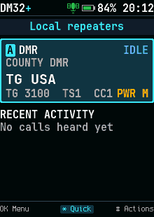
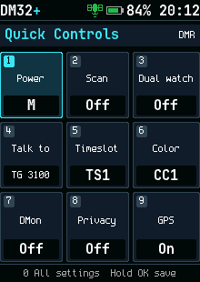
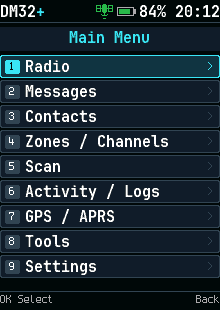

<!-- SPDX-License-Identifier: MIT -->
<!-- Copyright (c) 2026 Garrett Dothard -->

# RadioFoundry User Manual

How to install RadioFoundry and use it on the radio. The chapters describe what RadioFoundry does on every radio. The
[Radio reference](23-radios.md) lists what differs from radio to radio: the keys, power levels, battery, power switch
and display, and what has been checked on each. Each release also carries this manual as a PDF, built from these files
(`tools/build_manual.sh`, in file name order).

Start on this project's site or in the [portable CPS](../../tools/offline_cps/README.md): the **web installer** installs, updates, backs up
and restores a radio, and the **Codeplug Editor** edits channels, zones and contacts. Both run in a Chromium browser.
The chapters below name the command line tools as alternatives.

These show the card layout. The chapters also cover the standard Hub and smaller displays.

## Reading order

### Get started

1. [Introduction](01-introduction.md): what RadioFoundry is, project status, conventions
2. [Installing](02-installing.md): the web installer first, then the advanced rfoundry command line; updating, backups, going back
3. [First boot](03-first-boot.md): built-in channels, the first checks
4. [Programming the radio](04-programming.md): the Codeplug Editor, qdmr, RadioID contacts

### Use the radio

5. [Keys and navigation](05-keys-and-navigation.md): the five key rules, Find, temporary changes, key lock
6. [The Home screen](06-home-screen.md): what each region shows, receiving, transmitting
7. [Channels, zones and the VFO](07-channels-zones-vfo.md)
8. [FM](08-fm.md): squelch, monitor, tones, bandwidth, VOX, touch tones
9. [DMR](09-dmr.md): talk targets, replying, Recent, contacts, timeslot and color code, privacy, roaming
10. [Messages, call alert and radio check](10-messages-and-signaling.md)
11. [Emergency](11-emergency.md)
12. [Scan and dual watch](12-scan.md)
13. [APRS](13-aprs.md): positions on FM and over DMR, beacons, KISS and iGate with a computer
14. [Hotspot mode](14-hotspot.md): MMDVMHost and Pi-Star, SFR, two radios as a duplex repeater
15. [USB network mode](15-usb-network.md): IP over DMR, the status page, rig control, KISS, TFTP, SNMP, control station
16. [Battery and power](16-battery-and-power.md)

### Reference

17. [Settings](17-settings.md): every setting, its default and status
20. [Troubleshooting](20-troubleshooting.md)
21. [FAQ](21-faq.md)
22. [Glossary](22-glossary.md)
23. [Radio reference](23-radios.md): keys, power levels, battery, power switch, display, install values, programming and
    status of each radio

### Moving from the stock firmware

These chapters are for a radio that still runs the manufacturer's firmware and has a codeplug worth keeping. One
program installs RadioFoundry and carries the codeplug over. Without a chapter, install with the web installer and open
its backup in the Codeplug Editor ([Installing](02-installing.md#install-with-the-web-installer)).

The [Radio reference](23-radios.md) links the chapter from the radio's "Installing" section.

## Quick reference

Keys are named by their job. [Key roles](23-radios.md#key-roles) shows which key does each job on your radio.

| To | Press |
|---|---|
| Change channel | Channel knob, or **Up** / **Down** |
| Change zone | **Previous zone** / **Next zone**, or **OK**, **4**, pick a zone |
| Quick settings | **\*** |
| Open the menu (hub) | **OK** |
| Act on the last caller | **#** |
| Recent calls | **OK**, **6** on the card Main Menu; **OK**, **3** on the standard Hub |
| Talk to another talkgroup or ID | Hold **#** |
| Choose who to talk to | **Talk target** (DMR), or **\***, **4** on the Memory card grid (**8** on the standard grid) |
| Monitor | Hold **Monitor** |
| Dual watch on / off | Hold **Talk target**, or **\***, **3** on the Memory card grid (**7** on the standard grid) |
| Scan on / off | Card Main Menu: **OK**, **5**, select Start/Stop scan. Standard Hub: **OK**, **6**, **1** |
| Undo temporary changes | **Back** on Home |
| Save changes to the channel | Hold **OK** |
| Back to Home | Hold **Back** |
| Lock / unlock keys | Hold **\*** |

Developers: see the [developer documentation](../dev/README.md).
