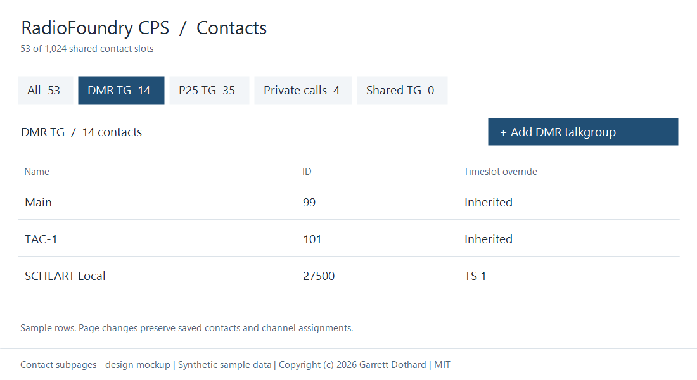
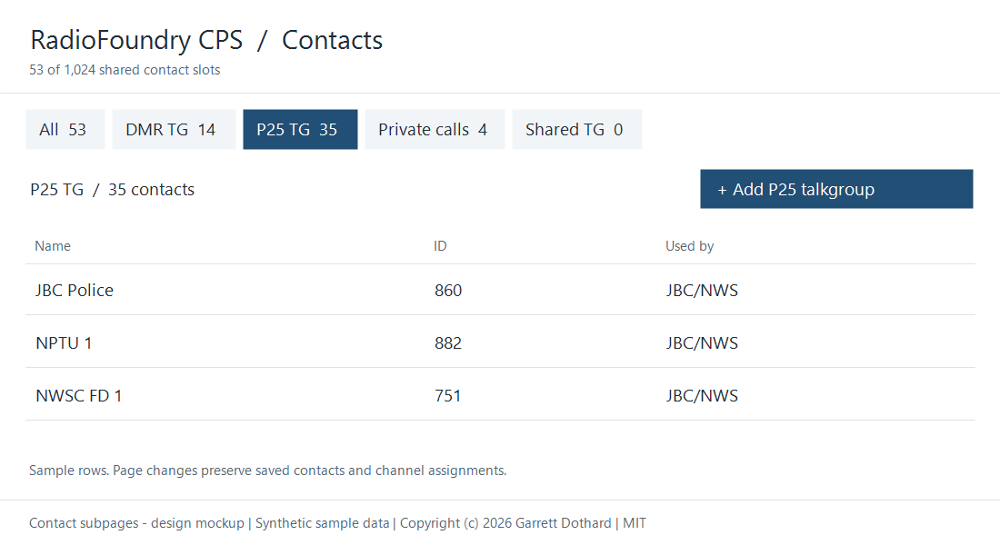
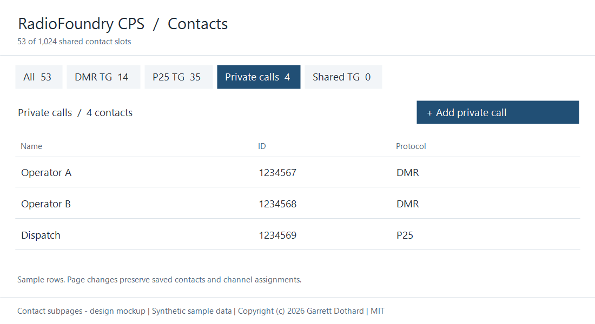

<!-- SPDX-License-Identifier: MIT -->
<!-- Copyright (c) 2026 Garrett Dothard -->

# CPS Contact subpages

Selected design for [issue #8](https://github.com/gjdothard/DM32Plus/issues/8). Design mockups, not implemented CPS screenshots. Synthetic sample rows and illustrative counts. Rendered with System.Drawing from the selected Contact subpages concept.

Contacts offers All, DMR TG, P25 TG, Private Calls (PC), and Shared TG. There is no All Call subpage. Existing all-call records remain preserved and accessible in All. Keep one underlying contact store and stable channel assignments.

The primary Add action uses the current page's protocol/type defaults. DMR groups show timeslot overrides; P25 groups omit them; private calls show protocol. Shared TG contains contacts explicitly scoped to both DMR and P25. No firmware, codeplug format, or CPS implementation change is included.
