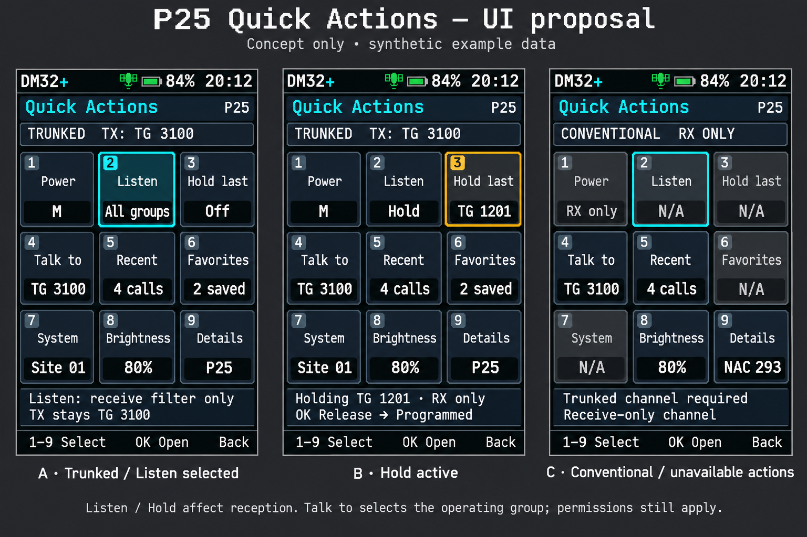

<!-- SPDX-License-Identifier: MIT -->
<!-- Copyright (c) 2026 Garrett Dothard -->

# P25 Quick Actions concepts

Design proposal only. These AI-generated mockups are not firmware captures or pixel-verified layouts. All displayed radio data is synthetic. No firmware implementation is included.

A: trunked listening filter. B: receive Hold active with a separate transmit target. C: conventional RX-only channel with unavailable actions dimmed and positions retained.

Tile positions, abbreviations and exact fit need review at native display resolution. System opens decoded identity/site information. Details opens channel/mode information (including NAC), avoiding duplicate destinations. The conventional operating-group picker must be checked against existing capability rather than assuming it is available. Power dimming on RX-only channels is a proposal, not current behavior. Hold release to Programmed is explicit and needs host coverage.

Generated with the built-in image-generation tool using the existing Quick Controls and P25 Listening gallery images as style references. The complete prompt is in prompt.txt.
