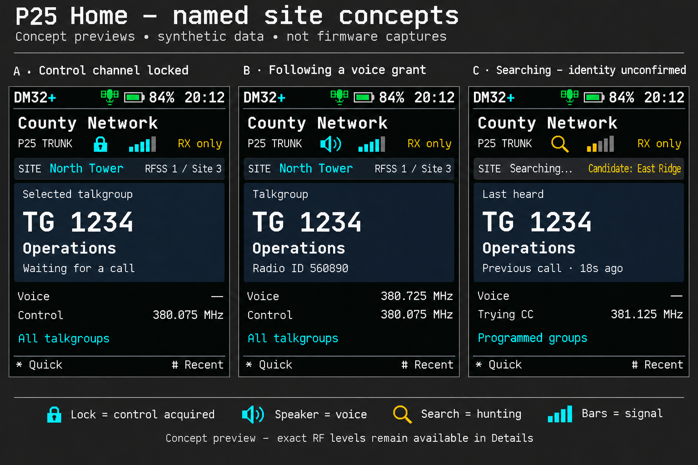

<!-- SPDX-License-Identifier: MIT -->
<!-- Copyright (c) 2026 Garrett Dothard -->

# Named-site P25 Home

Preferred concept for issue #7, selected by the owner. Generated with the built-in image-generation tool; synthetic data, not firmware captures or pixel-verified layouts.

Keep the mode label left, the state and signal icons centered, and RX-only right. Replace the separate control/voice/search state and dBm row with icons. Lock means control acquired, speaker means receiving voice, search means acquisition, and bars mean signal strength. Exact dBm belongs in Details. Keep voice/control-channel frequencies below the talkgroup card.

Retain the acquired serving-site name through voice following. During acquisition show a candidate explicitly, never as a confirmed site. Verify icon clarity and text fit at native resolution, and distinguish control lock from key lock and privacy indicators.
