<!-- SPDX-License-Identifier: MIT -->
<!-- Copyright (c) 2026 Garrett Dothard -->

# Firmware screenshots

These are actual firmware UI renders with synthetic simulator data. The tall dark card layout below
covers Home, menus, conversations, editors, and utility pages.
The other display folders retain their own standard layouts. Feature availability is listed in the
[feature matrix](../../feature-matrix.md).

## Home and Quick Controls

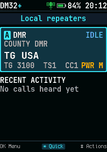
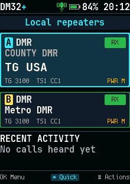
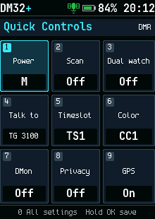

## Calls, channels, and targets

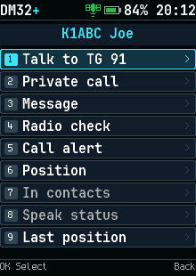
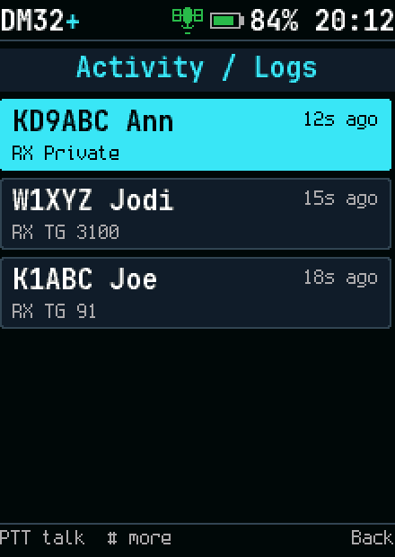
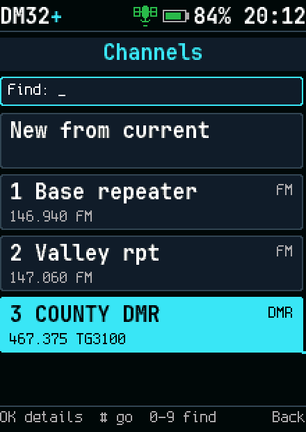
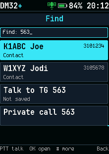
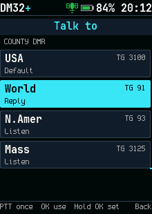
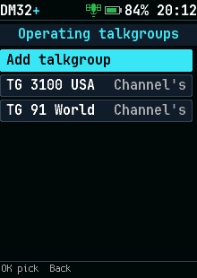

## Messages and conversations

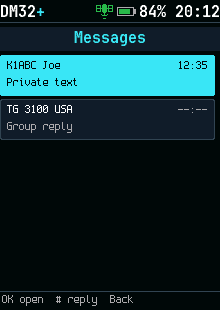
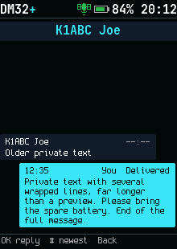
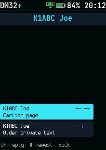

## Dual watch and settings

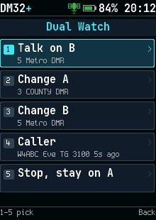
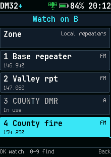
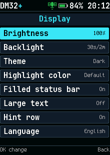
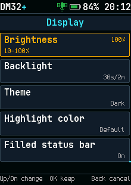
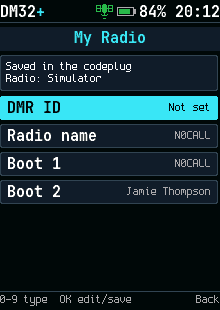
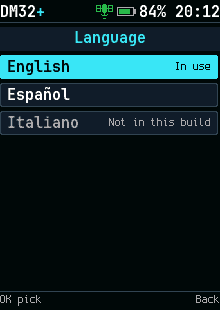

## Sharing, confirmations, and tools

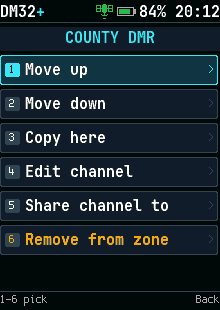
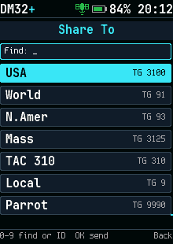
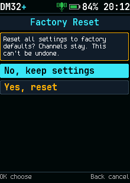
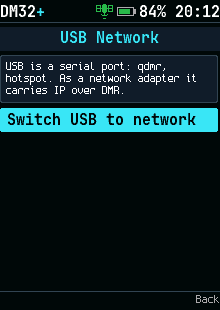
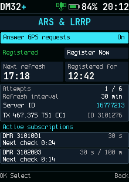

## Reproducing the gallery

Run `make -C tests/host ui-gallery`. The simulator uses its real input handlers, including the
`branded-home` layout and `history` fixture, to reach each screen. Its gallery build includes message
history support; this does not change a radio build's feature configuration.
Contact sheets are in `sheets/`. Review changed frames and keep only intended image changes.
See [UI testing](../../dev/testing.md#the-ui-simulator-and-the-gallery) for individual renders.
